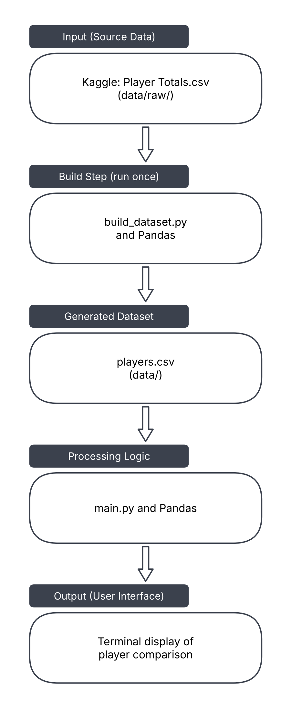

# Sports Stat Finder

A command-line tool that compares two NBA players' all-time career stats side by side, built with Python and pandas.

## The Problem

Comparing two NBA players across their whole careers usually means opening several tabs and lining up numbers by hand. This project aims to make that a one-step process: type two player names and get a clean side-by-side table of career per-game averages and shooting percentages, with a column showing who leads in each stat. It runs offline from a local dataset, so there is no live data to wait on or maintain.

## How It Works

The program reads a local CSV of career stats into a pandas DataFrame, looks up each player by name, and prints a comparison table to the terminal.



1. `scripts/build_dataset.py` (run once) reads raw season-by-season totals from Kaggle, adds up each player's NBA seasons, and writes `data/players.csv` with one row per player. Per-game averages and shooting percentages are recalculated from career totals.
2. `src/main.py` loads `players.csv` with pandas and finds each player by case-insensitive partial name match (the most-played player wins ties, so "James" finds LeBron James).
3. It builds a table comparing games played, points, rebounds, assists, steals, blocks, FG%, 3P%, and FT%, with an Edge column naming the leader for each stat. Stats that were not tracked in a player's era show as `N/A`.
4. A rankings mode (`get_rankings()` in `main.py`) lists the top players for any stat among players with a minimum number of games, so one-season wonders don't skew the list.
5. Choose a mode at the menu: `1` to compare two players, or `2` for top player rankings.

## Tech Stack

- **Language:** Python 3.10+
- **Libraries:** pandas (data loading, aggregation, comparison), pytest (testing)
- **Tools:** Git and GitHub (version control), VS Code (development)
- **Data storage:** flat CSV file (`data/players.csv`), generated from the Kaggle dataset "NBA Stats (1947-present)" by sumitrodatta (sourced from Basketball-Reference)

## Setup and Usage

You need Python 3.10 or newer and Git installed. The generated dataset is already included in the repo, so no downloads are required to run the program.

1. Clone the repo and enter the folder:
   ```
   git clone https://github.com/brodydavis/sports-stat-finder.git
   cd sports-stat-finder
   ```
2. Create and activate a virtual environment:
   ```
   python -m venv .venv
   source .venv/bin/activate        # Windows: .venv\Scripts\activate
   ```
3. Install dependencies:
   ```
   pip install -r requirements.txt
   ```
4. Run the program from the project root:
   ```
   python src/main.py
   ```
5. Enter two player names when prompted.


### Example run: comparing players

Input:
```
Choose 1 or 2: 1
First player: lebron
Second player: michael jordan
```

Output:
```
     Stat LeBron James Michael Jordan           Edge
     Games played         1627           1072              -
  Points per game         26.7           30.1 Michael Jordan
Rebounds per game          7.5            6.2   LeBron James
 Assists per game          7.4            5.3   LeBron James
  Steals per game          1.5            2.3 Michael Jordan
  Blocks per game          0.7            0.8 Michael Jordan
     Field goal %        50.7%          49.7%   LeBron James
        3-point %        34.8%          32.7%   LeBron James
     Free throw %        73.7%          83.5% Michael Jordan
```

### Example run: rankings

Input:
```
Choose 1 or 2: 2
Pick a stat number: 1
How many players? (default 10): 
Minimum games played? (default 500): 
```

Output:
```
1       Michael Jordan   1072             30.1
2     Wilt Chamberlain   1045             30.1
3          Luka Dončić    519             29.3
4         Elgin Baylor    846             27.4
5         Kevin Durant   1208             27.1
6           Jerry West    932             27.0
7        Allen Iverson    914             26.7
8         LeBron James   1627             26.7
9           Bob Pettit    792             26.4
10       George Gervin    791             26.2
```

### Running the tests

```
pytest
```

### Rebuilding the dataset (optional)

Download `Player Totals.csv` from the Kaggle dataset above into `data/raw/`, then run:
```
python scripts/build_dataset.py
```

## Roadmap

Planned with an [Eisenhower Matrix](Eisenhower%20Matrix.pdf).

- [x] Load and parse player stats with pandas
- [x] Search for a player by name
- [x] Print a clean summary of a player's stats to the terminal (MVP)
- [x] Side-by-side comparison between two players
- [x] Ranking tables of many playeres (top-N by any stat)
- [ ] Interactive UI

Out of scope: live real-time data, remote hosting, and machine learning predictions.

## Demo

[Video walkthrough](PASTE VIDEO LINk HERE)